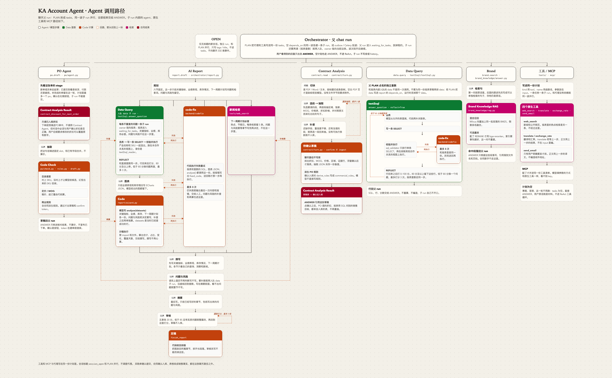

# KA Account Agent

面向品牌商与经销商的对话式运营工作台。支持通过聊天起草采购单、读取合同、生成叙述报告、查询业务数据，并在桌面页面管理产品、订单、合同、报表和长期记忆。

模型负责理解输入和撰写内容；采购价格、SKU、MOQ 和商业规则由确定性代码计算。具有副作用的操作需要用户确认，并以幂等方式执行。

## 功能

- **采购与订单**：从对话或图片提取需求，结合产品目录和合同规则生成采购草稿；确认后提交。聊天也支持收货、付款和破损索赔。
- **合同**：读取 PDF、Word 或文本协议，抽取商业条款及原文依据；用户确认后入库，供采购规则和折扣计算使用。
- **报表**：导入整洁销售表格为业务事实；在聊天中起草叙述报告，确认后保存。页面提供图表及“下单 vs 售出”视图。
- **业务查询**：将自然语言转换为经过校验的只读 SQL 并执行。
- **品牌资料**：按品牌混合检索上传文件，回答引用文件名和页码。
- **会话与记忆**：会话历史、run 轨迹和长期记忆分别存储；记忆只作为上下文，不参与定价或规则判定。

## 技术栈

Python 3.11+、FastAPI、SQLAlchemy 2、Alembic、Pydantic；React 19、TypeScript、Vite、Vitest；PostgreSQL 17、Redis 7、Celery、Milvus 2.5。开发和运行均通过 Docker Compose。

## 快速开始

### 需要

- Docker Desktop（含 Docker Compose）
- 可访问的模型服务及相应 API key

无需在宿主机安装 Python、Node 或 PostgreSQL。所有命令在 Compose 容器中运行（Windows 使用 `dev.bat`）。

### 启动

```bash
cp .env.example .env
# 编辑 .env，填写启用的模型/API 凭据
./dev
```

桌面：<http://localhost:5173>
API 文档：<http://127.0.0.1:8000/docs>

首次启动会下载镜像；Milvus 镜像较大，启动时间更长。Compose 会注入数据库、Redis 和 Milvus 的容器网络地址。不要在 `.env` 中配置 `KA_ACCOUNT_DB_URL`、`KA_ACCOUNT_REDIS_URL` 或 `MILVUS_URI`，也不要将容器地址改成 `127.0.0.1`。

### 常用命令

| 命令 | 用途 |
| --- | --- |
| `./dev` | 启动桌面、API、worker、Postgres、Redis 和 Milvus |
| `./dev api` | 启动 API、worker 及依赖，不启动前端 |
| `./dev db` | 启动 Postgres 并检查就绪状态 |
| `./dev test` | 运行 Python 测试 |
| `./dev test-web` | 运行前端 Vitest |
| `./dev lint` | 运行 Ruff |
| `./dev py ...` | 在 API 容器中运行 Python 命令 |
| `./dev catalog` | 导入本地 Open Food Facts 快照 |
| `./dev build` | 依赖变更后重建镜像 |
| `./dev kill` | 停止服务并保留数据库卷 |

产品目录是可选数据：

```bash
./dev py scripts/fetch_off_products.py
./dev catalog
```

`./dev catalog --dry-run` 只统计，不写入数据库。目录基于 Open Food Facts，批发字段由商品规格确定性推导；使用源数据请遵循其 ODbL 条款。

如果需要加载仓库自带的演示品牌、经销商、用户和产品数据：

```bash
./dev py scripts/seed_demo.py
```

## 配置

`.env.example` 列出全部可选项。常用配置：

| 配置 | 用途 |
| --- | --- |
| `DEEPSEEK_BASE_URL`、`DEEPSEEK_API_KEY` | 官方 DeepSeek（结构化 JSON / 工具 / 识图） |
| `QWEN_BASE_URL`、`QWEN_API_KEY` | 官方 Qwen（PLAN / ANSWER 等短文本） |
| `PO_EXTRACT_MODEL` | 可选的采购抽取模型覆盖 |
| `EMBEDDING_BASE_URL`、`EMBEDDING_API_KEY`、`EMBEDDING_MODEL`、`EMBEDDING_DIMENSIONS` | 品牌资料 embedding，与聊天模型分开配置 |
| `RERANK_BASE_URL`、`RERANK_API_KEY`、`RERANK_MODEL` | 可选的检索重排；URL 为空时跳过重排 |
| `GLM_API_KEY`、`GLM_BASE_URL` | PDF OCR |
| `WEB_SEARCH_URL` | 网页搜索。Compose 注入 Open-WebSearch（`http://web-search:3210`），不要写成 `127.0.0.1` |
| `SOCIALCRAWL_API_KEY` | 可选 SocialCrawl MCP |
| `SMTP_*`、`EMAIL_DRY_RUN` | 邮件发送配置及 dry run |
| `KA_ACCOUNT_OUTBOX_RETENTION_DAYS`、`KA_ACCOUNT_OUTBOX_CLEANUP_BATCH` | sweeper 保留已派发 outbox 的天数（默认 7）及每轮清理批量（默认 1000） |
| `KA_ACCOUNT_REDISPATCH_AFTER_SECONDS`、`KA_ACCOUNT_QUEUED_MAX_AGE_SECONDS` | queued 的 Run 超过多久才补投（默认 120 秒），以及排队超过多久没有任何动静就直接失败、不重放（默认 7200 秒） |

数据库连接池可通过 `KA_ACCOUNT_POOL_SIZE`、`KA_ACCOUNT_MAX_OVERFLOW`、`KA_ACCOUNT_POOL_TIMEOUT` 调整；Compose 里 worker / title-worker / sweeper 各自设了较小的池（总和要小于 Postgres 的 `max_connections` 减 3，算法见 A3 实验记录「连接预算」）。Qwen 单次调用的超时用 `KA_ACCOUNT_QWEN_TIMEOUT_SECONDS`（总时长，默认 30）和 `KA_ACCOUNT_QWEN_CHUNK_IDLE_SECONDS`（相邻 chunk 最长静默，默认 10）；超时走 `PROVIDER_TIMEOUT` 并 fallback。不要提交 `.env`，也不要在日志或文档中暴露密钥。

## 架构

```text
Vite/React ──HTTP──> FastAPI ──> PostgreSQL
                         │          ├─ 业务数据
                         │          └─ run 轨迹、outbox、job queue
                         ├── Redis ── Celery worker ── 模型与领域工具
                         └── Milvus ── 品牌资料向量
```

聊天请求由 API 创建 queued run 和出站任务，并返回 `run_id`；Celery worker 执行模型和工具，前端通过 SSE 或轮询读取轨迹。关闭页面或停止轮询不会取消任务，只有显式点击停止才会取消。需用户确认的工具会暂停在 `waiting_for_user`，确认后继续执行。补投、sweeper、租约与重试的完整行为见 [`docs/performance/run.md`](docs/performance/run.md) 与 [`docs/performance/retry.md`](docs/performance/retry.md)。

主要目录：

```text
backend/                 FastAPI、领域逻辑、任务执行、数据层
  po/                    采购、定价和规则
  contract/              合同读取、抽取和确认
  report/                销售事实导入和叙述报告
  text2sql/              自然语言查询及 SQL 校验
  brand_knowledge/       品牌资料检索与问答
  llm/, tools/, mcp/     模型客户端和工具集成
  db/                    ORM、Database 门面、Alembic migrations
  schemas/               Pydantic 对象和 HTTP 请求体
frontend/                React 桌面
scripts/                 快照下载与目录构建
tests/                   Python 与前端测试
docs/                    架构、运行时、实验与图示（索引见下文「文档」）
```

更完整的分层与模块说明见 [`docs/architecture/architecture.md`](docs/architecture/architecture.md)；Run 状态机、sweeper 与恢复契约见 [`docs/architecture/runtime.md`](docs/architecture/runtime.md)。

执行路径（Agent / 工具调用）：



可缩放原图见 [`docs/agent-call-paths.html`](docs/agent-call-paths.html)；一次聊天的队列与控制流见 [`docs/run-lifecycle.html`](docs/run-lifecycle.html)。

### HTTP API

启动 API 后可通过 FastAPI 的 `/docs` 查看交互式 OpenAPI 文档。桌面主要使用以下资源：

| 路径 | 用途 |
| --- | --- |
| `/api/sessions` | 会话列表、创建、归档和删除 |
| `/api/sessions/{id}/message` | 提交聊天消息 |
| `/api/runs/{id}/trace` | 读取 run 轨迹 |
| `/api/runs/{id}/cancel`、`/resume` | 取消或恢复需要确认的 run |
| `/api/catalog` | 产品目录搜索、分页和分类 |
| `/api/partnerships/{id}/contracts` | 合同列表和上传 |
| `/api/partnerships/{id}/reports` | 报表预览、导入和确认 |
| `/api/orders` | 订单查询 |

## 数据库与迁移

PostgreSQL 是唯一数据库引擎，不提供 SQLite 回落。业务数据按实体建模；JSON 列仅用于结构不固定的字段。时间戳使用 UTC-aware `timestamptz`。

新增或修改 schema：修改 `backend/db/orm/` 模型，生成迁移并人工检查：

```bash
./dev py -m alembic revision --autogenerate -m "describe change"
```

应用启动时迁移到 Alembic head。测试通过 `tests/conftest.py` 中的 `make_db` 使用临时 Postgres 数据库；模型调用使用 `FakeLLM`，不请求真实模型。

## 开发

- 领域逻辑留在后端领域模块，桌面通过 HTTP API 访问后端。
- 采购价格、SKU、MOQ 和商业规则由代码计算；模型只填充固定 slot。
- 确认 token 在创建订单前消费，避免重试造成重复提交。
- `backend/db/` 之外不直接导入 ORM；通过 `Database` 门面访问数据。
- Python 注释和 docstring 使用英文，面向用户的文档使用中文；修改模块前先阅读其 docstring。

运行检查：

```bash
./dev test
./dev test-web
./dev lint
```

## 文档

`docs/` 按主题分层。改编排、投递或清扫前先读对应一篇；压测与金标流程见 [`docs/performance/performance-test-plan.md`](docs/performance/performance-test-plan.md)。

### 架构与运行时

| 文档 | 内容 |
| --- | --- |
| [`docs/architecture/architecture.md`](docs/architecture/architecture.md) | 分层、数据流、监控与待优化项 |
| [`docs/architecture/runtime.md`](docs/architecture/runtime.md) | Run 状态机、租约、checkpoint、事件与 sweeper |
| [`docs/performance/run.md`](docs/performance/run.md) | Run 账本、领域与确定性代码边界、监控字段 |
| [`docs/performance/orchestrator.md`](docs/performance/orchestrator.md) | PLAN、波次并行、子 run 与 ANSWER |
| [`docs/performance/chat-flow.md`](docs/performance/chat-flow.md) | 从发消息到回复的叙述版时间线（onboarding） |
| [`docs/performance/retry.md`](docs/performance/retry.md) | 报错分类、重试预算、熔断与 sweeper 兜底 |

### 质量与评估

| 文档 | 内容 |
| --- | --- |
| [`docs/answer-quality.md`](docs/answer-quality.md) | 来源分级、草稿审核与运行时表述要点 |
| [`docs/resume-evaluation.md`](docs/resume-evaluation.md) | 回归用例、压测与简历数字的归类方式 |
| [`docs/performance/performance-test-plan.md`](docs/performance/performance-test-plan.md) | 固定测试层次、指标与实验记录约定 |

### 实验记录

实验室压测与金标结果写在 [`docs/experiments/records/`](docs/experiments/records/)：`00-summary.md` 汇总记录 01–38 的问题与修复；单条记录按编号命名。原始 JSON / 日志放在 [`docs/experiments/exports/`](docs/experiments/exports/)（见该目录 README）。金标执行入口：`docs/experiments/golden_set/run_golden.py`。

### 图示与其他

| 资源 | 内容 |
| --- | --- |
| [`docs/agent-call-paths.html`](docs/agent-call-paths.html) / [`agent-call-paths.png`](docs/agent-call-paths.png) | 父 run 与子 run 上的模型、工具与 MCP 路径 |
| [`docs/run-lifecycle.html`](docs/run-lifecycle.html) | 单次聊天的函数、队列与控制流 |
| [`docs/cv/interview.md`](docs/cv/interview.md) | 面试话术（另有 `interview.html` / `interview.pdf`） |

## 项目状态

已实现桌面多页面、异步聊天 run、采购及合同确认流程、销售事实导入、叙述报告、只读业务查询、品牌资料检索和长期记忆。目录页面支持数据库搜索与分页。
