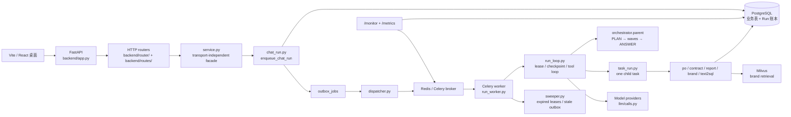

# KA Account Agent 架构方案

本文按当前代码描述系统实际架构，并记录后续需要优化的架构问题。代码变化后先更新本文，再更新运行时说明和测试路径。

## 1. 架构总览



系统的核心原则是：PostgreSQL 保存业务事实和 Run 账本，Redis 负责队列、租约和短暂的波次结果，Celery 只负责唤醒 Worker。模型负责理解和生成，采购价格、SKU、MOQ、折扣、SQL 安全和副作用幂等由代码负责。

## 2. 入口和分层

### HTTP 层

- `backend/app.py` 创建 FastAPI 应用，注册 `backend/router/` 和 `backend/routes/runs.py`。
- 请求模型位于 `backend/schemas/`，错误通过统一的 `AppError` 处理。
- `/api/sessions/{id}/message` 只负责接收消息和创建异步 Run；关闭 HTTP 流不会取消后台 Run。
- `/api/runs/{id}/trace`、`/api/runs/{id}/events/stream`、`/api/runs/{id}/cancel` 和 `/api/runs/{id}/resume` 提供运行时查看和控制。

### 领域门面

`backend/service.py` 不认识 HTTP 或前端框架，负责会话、确认、归档和订单等领域入口。聊天任务交给 `backend/orchestrator/` 与 `backend/services/chat_run.py`。

### 调度和执行层

- `backend/services/chat_run.py` 创建父 chat Run 和可选的 OPEN Run。
- `backend/orchestrator/parent.py` 执行 PLAN、按依赖分波、等待子 Run、收集结果并 ANSWER。
- `backend/orchestrator/gather.py` 创建子 Run、维护波次结果和重新唤醒 owner。
- `backend/services/task_run.py` 执行一条计划任务。
- `backend/services/run_loop.py` 负责单条 Run 的模型调用、工具调用、确认、checkpoint、幂等和错误处理。
- `backend/services/run_worker.py` 负责 claim、租约、状态迁移和基础设施重试。

## 3. 一条聊天消息的实际路径

```text
POST /api/sessions/{session_id}/message
  → chat_run.enqueue_chat_run
  → agent_runs(status=queued) + outbox_jobs
  → dispatcher.dispatch_pending
  → 返回 run_id（HTTP 请求到此结束）
  → Redis/Celery
  → run_worker.work_once
  → orchestrator.parent.execute_parent
  → PLAN 生成 tasks[]
  → gather.dispatch_wave 创建子 Run
  → 子 Run 执行领域流程或工具
  → checkpoint.results + Redis wave box
  → 父 Run 继续下一波或 ANSWER
  → orchestrator.speak.save_reply 写 history

GET /api/runs/{run_id}/events/stream?after={sequence}
  → 读取已落库事件
  → LISTEN/NOTIFY 等待新事件
  → SSE 返回进度和结果
  → 断线后按 sequence 续传
```

空计划会跳过子 Run，直接执行 ANSWER。需要用户确认的操作停在 `waiting_for_user`，确认端点只消费 token 和执行确定性确认流程，不重新让模型决定是否建单。

## 4. 领域边界

- `backend/po/`：采购槽位、目录解析、规则、草稿、确认和提交。价格、SKU、MOQ 和商业规则必须来自代码。
- `backend/contract/`：文件读取、条款抽取、原文依据和确认入库。
- `backend/report/`：销售表导入、数据分析、报表草稿、审核和确认。
- `backend/brand_knowledge/`：文档分块、向量/关键词混合检索、重排和来源回答。
- `backend/text2sql/`：结构化 SQL 生成、只读校验、合作关系作用域和结果回答。
- `backend/tools/` 与 `backend/mcp/`：外部工具和 MCP；副作用工具必须经过确认和幂等控制。
- `backend/memory.py`：长期记忆和会话摘要，只作为上下文，不参与采购定价或规则判定。

领域模块通过 `backend.db.Database` 访问数据库。`backend/db/` 之外不直接导入 ORM。

## 5. 数据和一致性

业务实体和运行账本都落在 PostgreSQL：

- 业务表：合作关系、产品、合同、订单、销售事实、报表和记忆；
- 运行表：`agent_runs`、`agent_steps`、`model_calls`、`tool_calls`、`checkpoints`、`run_events`、`outbox_jobs` 和死信；
- 用 Alembic 管理 schema，修改模型后生成迁移并人工检查。

Redis 不作为唯一事实来源：

- Celery broker 负责投递；
- Lease 负责 org、用户、模型和工具并发控制；
- wave box 暂存当前波次子任务结果；
- Redis 丢失时从 PostgreSQL checkpoint 和子 Run 结果恢复。

副作用工具先 claim 幂等键，再调用外部系统。请求超时但可能已经发出时记录 `response_lost`，进入人工复核，不自动重复执行。

父 Run 和子 Run 的结果信封是 `id`、`kind`、`name`、`status`（`succeeded` / `failed` / `skipped`）、`ok`、`error`、`payload`。不在 `AGENT_NAMES` 里的 agent 会被丢掉，次数记在 PLAN 步骤的 `dropped.unknown_agent` 上；留下来的任务如果还依赖这个 id，或者 `depends_on` 指向不存在的任务，或者成环，PLAN 步骤失败，错误码分别是 `plan_depends_on_unknown_agent`、`plan_unknown_dependency`、`plan_cycle`，不写 `planned` checkpoint，也不派发。`/monitor` 用 PLAN 步骤数做分母显示这些比例。报表把自己的 data 任务收进草稿时，会同时拿掉那条依赖。同一 `task_id` 的结果以第一次写入为准。checkpoint 整行丢失时，从成功的 PLAN 步骤和子 Run 的 `output_json` 恢复，不重新 PLAN。ANSWER 收到全部结果，包括失败和跳过。契约在 `tests/test_orchestrator_contract.py`。

`/monitor` 的完成时间和排队时长是分桶直方图，柱上标出 P50、P95 和 P99 落在哪一桶。完成时间只统计成功的 run，失败另有计数；排队只统计已经开始的 run。SLO 是服务等级目标，就是页面上的「目标 / 阈值 / 现在」表。完成时间 P95 < 60 秒，P99 < 120 秒；排队 P95 < 10 秒，P99 < 30 秒。阶段耗时从现有时间戳计算：排队、claim、PLAN、子任务、模型、工具、ANSWER、写 history。入队时刻是 `agent_runs.created_at`，请求进到这一行之前没有单独的耗时。Prometheus 现在是 16 个名字（新增 `agent_oldest_queued_age_seconds`，最老 queued Run 的等待秒数），直方图标签只有 `le`。完成时间的桶到 300 秒，并覆盖 180 秒超时；模型调用的桶到 30 秒。

### 当前运行标准

本地闸门是 Redis 里的同时占用数。厂商额度是 RPM / TPM / 账户并发。压测并发取两者里更紧的一档。改数字先改这一节，再改环境变量或 `entry_guard.py` 默认值。

#### SLO（`/monitor` 的「目标 / 阈值 / 现在」）

| 目标 | 阈值 | 现状 |
|---|---|---|
| 发消息建 run 的延迟 P95 | < 300ms | 没有单独记这一跳 |
| run.created 成功率 | > 99.9% | 拒绝发生在写入之前，没有分母 |
| 普通 run 完成时间 P50 | 必报，暂不设阈值 | 页面和压测都输出 |
| 普通 run 完成时间 P95 | < 60s | 只含 `succeeded` |
| 普通 run 完成时间 P99 | < 120s | 只含 `succeeded`；压测成功样本不足 300 不报 |
| run.failed 比例 | < 1% | 失败计数，不进完成时间百分位 |
| send_email / MCP 错误率 | < 0.1% | |
| 排队等待 P95 | < 10s | 只含已经开始的 run |
| 排队等待 P99 | < 30s | |
| 卡住的 run | < 10 | 排队超过 10 分钟，或 `running` 且租约已过期 |
| 单 org 每日费用 | 默认不封顶 | `KA_ACCOUNT_ORG_DAILY_TOKENS` / `KA_ACCOUNT_ORG_DAILY_COST_CENTS`，0 表示不限制 |

#### 超时

| 位置 | 现在的值 | 代码 |
|---|---|---|
| 压测 HTTP（建会话 / 发消息） | 30s | `scripts/load_test_chat.py --request-timeout` |
| 压测等到 assistant 回写 | 180s | `--completion-timeout`；超时进 `timeouts`，不进成功百分位 |
| 模型 SDK 客户端 | 7200s | `LLMSettings.timeout`，OpenAI 兼容 SDK |
| OCR | 180s | urllib |
| MCP HTTP | 60s | `backend/mcp/runtime.py` |
| `web_search` / `translate` / `exchange_rate` / `send_email` | 30s | 工具注册表 |
| `po.draft` / `contract.read` / `report.draft` | 300s | 工具注册表；租约 10 分钟，这些不算卡住 |
| `data.query` / `brand.search` | 120s | 工具注册表 |
| MCP 副作用工具 | 60s | 工具注册表 |
| 副作用停在 `running` | 90s 后记 `response_lost` | sweeper |
| 数据库语句 | 120s | `KA_ACCOUNT_STATEMENT_TIMEOUT_MS` |
| 连接池拿连接 | 30s | `KA_ACCOUNT_POOL_TIMEOUT` |
| Qwen 单次调用（总时长 / chunk 间静默） | 30s / 10s | `KA_ACCOUNT_QWEN_TIMEOUT_SECONDS`、`KA_ACCOUNT_QWEN_CHUNK_IDLE_SECONDS` |
| Run 租约 | 10 分钟 | `LEASE_FOR` |
| `waiting_for_tasks` 无在途子女 | 15 分钟后清扫 | sweeper |
| `queued` 已投递仍未领 | 120 秒宽限期后、且该队列在 Redis 里为空时，按 `queued_at` 过滤并补投，10 分钟记 `run.queue_stale` | 最多补投 3 次；仍未领取则失败并死信；排队超 1 小时直接失败 |
| 已派发 outbox | 终态 Run 保留 7 天 | sweeper 每轮分批清理，仍 queued 的行保留 |
| `waiting_for_user` | 1 天记提醒 | 不自动确认 |
| `max_duration_seconds` | 默认空，不封顶 | 有值时领到或清扫超时记 `COST_BUDGET_EXCEEDED` |
| Retry-After 上限 | 300s | 厂商 429 |
| 无 Retry-After 的基础设施退避 | 1s 起，封顶 60s | 本地槽满从 5s 起 |
| 熔断冷却 | 30s | `KA_ACCOUNT_CIRCUIT_COOLDOWN_SECONDS` |

#### 厂商额度（对照日期 2026-11-09）

问候路径会打官方 `qwen3.7-flash` 做 PLAN 和 ANSWER（短文本优先走 Qwen），结构化 JSON / 工具 / 识图走官方 `deepseek-flash`。没有校园网关路径。DeepSeek 账户并发 2500、Qwen 华北 2 的 3 万 RPM 都远高于现在的 worker 5，压测时可以忽略，不要靠加 worker 并发掩盖排队/闸门/补投问题。

| brand | 官网额度 | 对我们的含义 |
|---|---|---|
| `qwen`（`qwen3.7-flash`，华北 2） | 30_000 RPM，5_000_000 TPM | PLAN、ANSWER、标题、翻译等短文本。高于 worker 5，本地闸门碰不到 |
| `deepseek`（官方 `deepseek-flash`） | 账户级并发 2500 | 结构化 JSON、工具、识图、报表。高于 worker 5，本地闸门碰不到 |
| GLM-OCR | MaaS `connection_pool_size=16`，自部署 `max_workers=16`；429/5xx/504 有限重试 | 这是他们 SDK 的连接池，不是聊天 RPM。我们 OCR 走 urllib，超时 180 秒，没有接这套池子 |

`KA_ACCOUNT_GATE_MODEL` 现在所有 brand 共用一个数字 32。官方额度远高于 worker 5，暂时够用。

#### 并发和限流

| 闸门 | 文档目标 | 代码默认 | 环境变量 / 位置 |
|---|---|---|---|
| Celery worker 进程（聊天队列 `ka_account`） | 5 | 5 | `compose.yaml --concurrency=5` |
| Celery title-worker（`ka_account.title`） | 3 | 3 | `compose.yaml title-worker --concurrency=3`（2 时标题吞吐约 0.8 条/s，追不上约 0.95 条/s 的对话完成速度，队列会积压） |
| 全局同时 `running` | 100 | 100 | `KA_ACCOUNT_GATE_GLOBAL` |
| 每个 org 同时 `running` | 20 | 10 | `KA_ACCOUNT_GATE_ORG` |
| 每个用户同时 `running` | 5 | 5 | `KA_ACCOUNT_GATE_USER` |
| 每家发信和 MCP | 3 | 3 | `KA_ACCOUNT_GATE_SIDE_EFFECT` |
| 每家搜索 / 查数 / 翻译 / 汇率 | 20 | 20 | `KA_ACCOUNT_GATE_READ_TOOL` |
| 每个模型 brand 同时调用 | 官方保持宽松 | 32（所有 brand 同一数字） | `KA_ACCOUNT_GATE_MODEL` |
| 每分钟创建 run | org 1000 / 用户 200 | 同左 | `KA_ACCOUNT_RATE_CREATE_*` |
| 每分钟读 run | org 10000 / 用户 2000 | 同左 | `KA_ACCOUNT_RATE_READ_*` |

表里「文档目标」改了而代码默认没改时，不设环境变量就不会生效。同一会话同时只跑一轮。冒烟并发先跟线上一致的闸门一起看，不要为了抬完成率去加 worker。`sweeper` 有 DB 探活；compose 变更后确认它与 `postgres` 仍在同一网络（`docker compose ps` 显示 healthy）。

#### 限流、熔断、降级、重试（以及超时、隔离、预热）

有退避。不是一层 sleep，是 outbox 的 `next_attempt_at`。厂商 429 优先听 `Retry-After`（扰动 0.9–1.1，上限 300 秒）；没有这个头则 full jitter 指数退避，1、2、4…封顶 60 秒。本地模型槽满从 5 秒起。SDK `max_retries=0`，避免客户端再叠一层。

| 能力 | 有没有 | 现在怎么做 |
|---|---|---|
| 限流 | 有 | HTTP 按分钟计数；Run / 工具 / 模型用 Redis 闸门 |
| 熔断 | 有 | 按 brand 连续 5 次 429/5xx/timeout/network，冷却 30 秒，允许一次半开探测 |
| 重试 | 有 | 见下一表。厂商错误走短退避；业务错误现在是 1 / 5 / 15 分钟 |
| 超时 | 有 | 模型、工具、数据库、压测、租约各有上限，见上面「超时」 |
| 隔离 | 部分有 | API / worker / sweeper 分进程；org、用户、模型、工具分闸门。worker 进程不按 brand 拆开 |
| 降级 | 基本没有 | 可以关掉发信、MCP、领新任务。没有备用模型，熔断后不会改口回一句占位，采购抽槽失败会留下一版旧草稿 |
| 预热 | 没有 | 没有连接预热、缓存预热、流量爬坡 |

业务重试（JSON 解析失败、未归类的异常）间隔是 **1 分钟、5 分钟、15 分钟**，共 3 次，然后死信。HTTP 已经返回 `run_id`，前端 SSE 还在等，所以这 5 分钟用户看得到。对话不该用这一档。短重试给到用户（5 秒、30 秒，再失败就结束并说明）；长退避只留给没有人盯着的后台，并且要先写一句占位。现在没有「占位回复 + 5 分钟后再跑」这条路径，5 分钟和 15 分钟不该用在 chat 上。厂商 429 已经是短退避，不走 1/5/15 分钟。

| 规则 | 现在的值 | 对话建议 |
|---|---|---|
| 模型 SDK 内部重试 | 0 | 保持 0 |
| 厂商 429 / 5xx / 超时 | Retry-After 或 1～60 秒 jitter | 保持短退避 |
| 本地模型槽满 | 从 5 秒起 | 保持 |
| 业务 outbox | 1 分钟、5 分钟、15 分钟，3 次后死信 | 改成 5 秒、30 秒，再失败就结束 |
| worker 丢失再投 | 3 | 保持 |
| 读工具同一行再试 | 最多 2 次 | 保持 |
| 副作用自动重试 | 0 | 保持 |
| 熔断 | 5 次 / 30 秒 | 日常若是配额不够而不是宕机，阈值可调到 10～20 |

#### 压测怎么报百分位

| 成功样本 | 报什么 |
|---|---|
| < 20 | 只看完成率和超时，不报百分位当成绩 |
| 20～299 | P50 和 P95；P99 留空 |
| ≥ 300 | P50、P95、P99 |

`tests/test_performance_metrics.py` 用假耗时锁住这两档算法，不调模型，也不是第一次实验记录。真实数字来自 `scripts/load_test_chat.py`，命令和记录模板在 [`../performance/performance-test-plan.md`](../performance/performance-test-plan.md)。

## 6. 当前架构优点

1. HTTP、调度、领域逻辑和数据库门面分层清楚。
2. 父 Run 和子 Run 解耦，任务按波次并行，不在 Celery 任务中等待另一个 Celery 任务。
3. PostgreSQL 是运行事实来源，Redis 只承担队列和短暂协调。
4. 模型调用、工具调用、Token、错误和耗时都可以从 Run trace 追溯。
5. 确认 token、工具 claim 和副作用幂等键降低重复提交风险。

## 7. 需要优化或补强的地方

### 7.1 把父 Run 和子 Run 的协议固定成版本化接口

当前 PLAN 输出、子 Run `input_json`、wave result 和 ANSWER 输入之间依赖多个模块约定。建议增加一个明确的协议版本，例如 `plan_version` 和 `task_payload_version`，并为以下边界增加 contract test：

- PLAN 任务名不在注册表中；
- `depends_on` 指向不存在或循环依赖；
- 子 Run 结果重复写入；
- checkpoint 丢失但子 Run 已完成；
- ANSWER 收到失败、跳过和成功混合结果。

对应代码：`backend/orchestrator/plan.py`、`backend/orchestrator/gather.py`、`backend/orchestrator/parent.py`。

#### 解决方案

没有增加 `plan_version` 和 `task_payload_version`。结果信封固定为 `id`、`kind`、`name`、`status`（`succeeded` / `failed` / `skipped`）、`ok`、`error`、`payload`。

- 不在 `AGENT_NAMES` 里的 agent 丢掉，次数记在 PLAN 步骤的 `dropped.unknown_agent`。没有人依赖它时，这次 PLAN 仍然成功。
- 留下来的任务如果还依赖这个 id，或者 `depends_on` 指向不存在的任务，或者成环，PLAN 步骤失败。错误码分别是 `plan_depends_on_unknown_agent`、`plan_unknown_dependency`、`plan_cycle`。不写 `planned` checkpoint，也不派发。
- 同一 `task_id` 以第一次写入为准。后来的不同结果记 `wave.result_ignored`，不覆盖。
- checkpoint 整行丢失时，从成功的 PLAN 步骤和子 Run 的 `output_json` 恢复，不重新 PLAN。
- ANSWER 收到成功、失败和跳过。报表把自己的 data 任务收进草稿时，同时拿掉那条依赖。

`/monitor` 用 PLAN 步骤数做分母，显示丢掉未知 agent 和上面三种失败的比例。契约在 `tests/test_orchestrator_contract.py`。

### 7.2 把监控指标从 P95 扩展到 P99，并拆分阶段耗时

当前 `/monitor` 和 `Database.monitor_facts()` 主要提供完成时间、排队等待和模型调用 P95。架构评测还需要区分 HTTP 入队、排队、claim、PLAN、子任务、模型、工具、ANSWER 和写 history 的耗时，并补充 P99。

对应代码：`backend/services/monitor.py`、`backend/db/database/run.py`、`backend/schemas/run.py`。

#### 解决方案

账本上的精确分位是 P50、P95、P99（`percentile_cont`）。没有样本时是 null，不是 0。阶段从现有时间戳计算：排队、claim、PLAN、子任务、模型、工具、ANSWER、写 history。完成时间、模型和工具的百分位只含成功样本；失败和超时另有计数。排队只含已经开始的 run。HTTP 收到请求到写入 `agent_runs` 之前仍没有单独的耗时。

Prometheus 现在是 16 个名字（新增 `agent_oldest_queued_age_seconds`）。直方图标签只有 `le`，不带 `run_id`、`session_id` 或用户 ID。完成时间的桶延伸到 300 秒，并在 1 到 180 秒之间加密。模型调用的桶到 30 秒，比端到端短。超过最大桶的值只记成大于最大桶。

压测按样本量分开报。成功样本不足 300 时只报 P50 和 P95，P99 留空：100 条压测里每一类 agent 大约二十条，这个切片上的 P99 就是最慢的那一条。300 条及以上的汇总才报 P95 和 P99。超时计入 timeouts，不进入成功样本。这两档在 `tests/test_performance_metrics.py`，不调模型。`/monitor` 是长期账本，三档都给，旁边有样本数。

### 7.3 明确模型路由和降级策略

当前不同步骤已经使用不同模型，但模型选择、质量门槛、成本上限和故障降级还应形成配置化策略。任务类型、首选模型、备用模型、最大 Token、最大调用次数和质量门槛应写成版本化配置，并在 trace 中记录决策原因。

#### 修改情况

已完成第一版路由和 trace 记录：

- 新增 `backend/llm/routing.py`，定义 `ROUTING_POLICY_VERSION`、`RoutePolicy`、首选模型、备用模型、最大 Token、最大模型调用次数、质量门槛和可降级错误。
- `backend/llm/calls.py::call_model` 现在统一读取路由策略；已配置的 purpose 使用首选/备用模型，未单独配置但带 purpose 的调用也会进入兼容路由，保留原模型为首选，并按 provider 使用安全的通用备用模型。
- 首选模型调用失败时，对配置的 `ProviderError`、`ModelCapacityExceeded`、结构化结果解析错误和质量门槛失败尝试备用模型。
- 已实现 `valid_task_plan`、`valid_po_slots` 和 `non_empty_answer` 三类确定性质量门槛；失败会写 `model.quality_gate_failed`，并按策略决定是否降级。
- 质量门槛采用 fail-closed：只有已注册的门槛可以通过，未知或拼写错误的 `quality_gate` 会失败并写入 trace，不能因为落入默认分支而放行。
- PLAN 依赖关系使用迭代式 Kahn 拓扑检查，不使用递归 DFS；依赖存在性和入度图在同一轮构建，避免重复校验和深链 `RecursionError`。
- 路由事件的 `decision` 和 `reason` 使用受限枚举/原因码，具体异常细节写入 `reason_detail`，便于按原因聚合统计。
- 每次首选或备用选择写入已有 `run_events`，事件名为 `model.route_selected` 或 `model.route_fallback`，不新增 trace 表。事件包含任务、策略版本、provider、model、候选序号、原因、回退来源、质量门槛和预算元数据，不包含 Prompt 或密钥。
- 路由事件加入子 Run 到父 Run 的投影集合，父聊天 Run 的 trace 也能看到子任务的路由和降级。
- `/monitor` 的运行指标增加 `route_selected`、`route_fallback` 和 `route_quality_gate_failed`，可观察路由使用量和质量门槛失败量。
- 现有接口 `GET /api/runs/{run_id}/trace` 会直接返回这些事件；读取实现为 `backend/db/database/run.py::run_trace`，路由为 `backend/routes/runs.py`。
- 新增 `tests/test_model_routing.py`，覆盖策略元数据、兼容 purpose、ProviderError fallback、trace 事件、质量门槛失败和 fallback。
- `max_model_calls` 和 `max_tokens` 现在按同一 Run、同一 purpose 从已有 `model.completed` trace 统计并拦截；Run 级预算仍由 `agent_runs.max_tokens`、`agent_runs.max_model_calls` 和 `backend/llm/calls.py::_budget` 执行。两层预算都不会把失败的 Provider 调用当成成功业务调用。

后续实现顺序：

1. 增加更多领域专用质量门槛和真实数据库 trace 测试；
2. 根据 trace 中的失败原因和 Token/延迟数据调整模型策略。

### 7.4 增加配置和数据版本（先不做）

同一条 Run 的结果受 Prompt、模型、工具 Schema、数据库 Fixture 和检索索引影响。建议在 Run 中记录 `prompt_version`、`model_config_version`、`tool_registry_version`、`dataset_version` 和 `retrieval_index_version`，否则后续无法可靠复现实验。

### 7.5 测试执行路径和生产执行路径

`work_chat` 仍只给单测做同步 drain，生产仍由 dispatcher 把 outbox 交给 Celery `execute_run`，再由 sweeper 处理过期租约和滞留的 `waiting_for_tasks`。两条路径执行时都进入 `work_once`。差别在谁交出下一次 `run_id`：drain 按父 run、子 run 的状态往下领；生产按 outbox 逐条投递，租约过期后由 sweeper 把 `running` 收回 `queued` 再投递。

#### 已解决
断点续传现在走同一条清扫。`work_chat` 看到根 run 或子 run 仍是 `running`、租约已经过期时，先调用 `sweep_expired_leases`，再 `dispatch_pending` 把清扫写下的 outbox 标成已派发，然后继续 drain。这样 `run.requeued_by_sweeper` 和随后的 `run.enqueued` 发生在下一次 claim 之前，和 sweeper 进程每轮末尾的派发一致。单测里模拟 worker 在副作用 claim 之后丢失，再次 drain 不会停在 `running` 上。

契约在 `tests/test_execution_contract.py`。同一条发信计划分别走 `work_chat` 和生产形驱动（sweeper，再按待投递 outbox 逐条 `work_once`）。pytest 里 dispatcher 不连 Celery，驱动把已派发且仍是 `queued` 的 run 当成 Celery 会收到的那一次投递。两边核对的是同一份账本：

- 父 run、子 run 的终态和状态事件（含 `run.waiting_for_tasks`、`run.requeued_by_sweeper`、`run.completed`）；
- checkpoint 的 phase 顺序（`planned` 到 `answer_done`；成功的子任务还有 `tool_done`）；
- 副作用幂等键和 `tool_calls.status`。

worker 在 `send_email` 已经 claim、处理函数还没写完结果时丢失：两条路径都只进入一次处理函数。清扫重新入队后，原来的 `running` 幂等行变成 `response_lost`，不再发信。父 run 沿 checkpoint 做 ANSWER，不重新 PLAN。`waiting_for_tasks` 超过 15 分钟、Redis 唤醒丢失的情况仍只由 sweeper 处理，drain 不会把这个窗口缩短。

### 7.6 补齐 response_lost 的外部对账能力

当前 `response_lost` 能阻止自动重发，但发信和 MCP 尚没有统一的外部查询/对账接口。这行被冻住之后没有收尾：`repair` 只追加 `data.repair` 审计，不改 `tool_calls`。

#### 修改方案

收尾只改同一行 `tool_calls`，不重新发送，也不释放幂等键。人工确认已经发出，把该行改成 `succeeded` 并写下回执；确认没发出，改成 `failed`；仍然查不清，保持 `response_lost`。同时写审计，记下操作者、原因、结论、改前状态和改后状态。run 状态不动。`complete_tool_call` 继续只收 `running`，不拿来做这次迁移。认定没发出之后，相同业务键仍然 `skipped_duplicate`；要重发必须是用户再次确认后的新副作用。

查询是这条收尾的只读来源，有下游能按原幂等键回答时才用。输入是该行已有的键和当时的参数：发信是 `send_email:{org_id}:{to}:{主题和正文摘要}`，MCP 是 `mcp:{org_id}:{工具名}:{参数摘要}`。下游认这笔键并给出回执则成功，明确说没接过则失败，查不了或结果不确定则保持 `response_lost`。成功或失败写回同一行并记同一类审计。

现在的 SMTP 没有按键查询，发信查询固定返回不确定，仍靠人工确认。要查发信，下游必须在发送时收下这笔键，并能按键查状态。MCP 只有在服务器声明了按这笔键查询的只读工具时才调用它；没有声明则返回不确定，不调用原来的写工具。sweeper 和 worker 继续只把超时的 `running` 收成 `response_lost`，不调用查询，也不重发。

## 8. 架构评审检查清单

每次新增 Agent、工具或数据库实体时，至少检查：

- 是否明确模型、代码和人的职责边界；
- 是否有输入、输出、错误码和版本化协议；
- 是否有权限、数据范围和副作用确认；
- 是否有幂等键、重试边界和 response_lost 处理；
- 是否有队列、模型、工具和数据库的容量指标；
- 是否能从 trace 还原一次请求；
- 是否有迁移、灰度、回滚和 Runbook；
- 是否有对应的单测、集成测试和压测入口。

