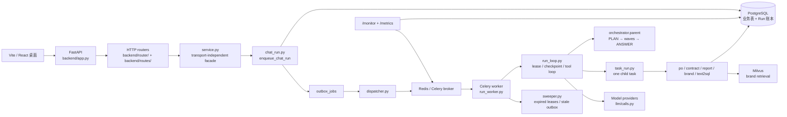

# KA Account Agent 架构方案

本文按当前代码描述系统实际架构，并记录后续需要优化的架构问题。代码变化后先更新本文，再更新运行时说明和测试路径。

## 1. 架构总览



系统的核心原则是：PostgreSQL 保存业务事实和 Run 账本，Redis 负责队列、租约和短暂的波次结果，Celery 只负责唤醒 Worker。模型负责理解和生成，采购价格、SKU、MOQ、折扣、SQL 安全和副作用幂等由代码负责。

## 2. 入口和分层

### HTTP 层

- `backend/app.py` 创建 FastAPI 应用，注册 `backend/router/` 和 `backend/routes/runs.py`。
- 请求模型位于 `backend/schemas/`，错误通过统一的 `AppError` 处理。
- `/api/sessions/{id}/message` 只负责接收消息和创建异步 Run；关闭 HTTP 流不会取消后台 Run。
- `/api/runs/{id}/trace`、`/api/runs/{id}/events/stream`、`/api/runs/{id}/cancel` 和 `/api/runs/{id}/resume` 提供运行时查看和控制。

### 领域门面

`backend/service.py` 不认识 HTTP 或前端框架，负责会话、确认、归档和订单等领域入口。聊天任务交给 `backend/orchestrator/` 与 `backend/services/chat_run.py`。

### 调度和执行层

- `backend/services/chat_run.py` 创建父 chat Run 和可选的 OPEN Run。
- `backend/orchestrator/parent.py` 执行 PLAN、按依赖分波、等待子 Run、收集结果并 ANSWER。
- `backend/orchestrator/gather.py` 创建子 Run、维护波次结果和重新唤醒 owner。
- `backend/services/task_run.py` 执行一条计划任务。
- `backend/services/run_loop.py` 负责单条 Run 的模型调用、工具调用、确认、checkpoint、幂等和错误处理。
- `backend/services/run_worker.py` 负责 claim、租约、状态迁移和基础设施重试。

## 3. 一条聊天消息的实际路径

```text
POST /api/sessions/{session_id}/message
  → chat_run.enqueue_chat_run
  → agent_runs(status=queued) + outbox_jobs
  → dispatcher.dispatch_pending
  → 返回 run_id（HTTP 请求到此结束）
  → Redis/Celery
  → run_worker.work_once
  → orchestrator.parent.execute_parent
  → PLAN 生成 tasks[]
  → gather.dispatch_wave 创建子 Run
  → 子 Run 执行领域流程或工具
  → checkpoint.results + Redis wave box
  → 父 Run 继续下一波或 ANSWER
  → orchestrator.speak.save_reply 写 history

GET /api/runs/{run_id}/events/stream?after={sequence}
  → 读取已落库事件
  → LISTEN/NOTIFY 等待新事件
  → SSE 返回进度和结果
  → 断线后按 sequence 续传
```

空计划会跳过子 Run，直接执行 ANSWER。需要用户确认的操作停在 `waiting_for_user`，确认端点只消费 token 和执行确定性确认流程，不重新让模型决定是否建单。

## 4. 领域边界

- `backend/po/`：采购槽位、目录解析、规则、草稿、确认和提交。价格、SKU、MOQ 和商业规则必须来自代码。
- `backend/contract/`：文件读取、条款抽取、原文依据和确认入库。
- `backend/report/`：销售表导入、数据分析、报表草稿、审核和确认。
- `backend/brand_knowledge/`：文档分块、向量/关键词混合检索、重排和来源回答。
- `backend/text2sql/`：结构化 SQL 生成、只读校验、合作关系作用域和结果回答。
- `backend/tools/` 与 `backend/mcp/`：外部工具和 MCP；副作用工具必须经过确认和幂等控制。
- `backend/memory.py`：长期记忆和会话摘要，只作为上下文，不参与采购定价或规则判定。

领域模块通过 `backend.db.Database` 访问数据库。`backend/db/` 之外不直接导入 ORM。

## 5. 数据和一致性

业务实体和运行账本都落在 PostgreSQL：

- 业务表：合作关系、产品、合同、订单、销售事实、报表和记忆；
- 运行表：`agent_runs`、`agent_steps`、`model_calls`、`tool_calls`、`checkpoints`、`run_events`、`outbox_jobs` 和死信；
- 用 Alembic 管理 schema，修改模型后生成迁移并人工检查。

Redis 不作为唯一事实来源：

- Celery broker 负责投递；
- Lease 负责 org、用户、模型和工具并发控制；
- wave box 暂存当前波次子任务结果；
- Redis 丢失时从 PostgreSQL checkpoint 和子 Run 结果恢复。

副作用工具先 claim 幂等键，再调用外部系统。请求超时但可能已经发出时记录 `response_lost`，进入人工复核，不自动重复执行。

## 6. 当前架构优点

1. HTTP、调度、领域逻辑和数据库门面分层清楚。
2. 父 Run 和子 Run 解耦，任务按波次并行，不在 Celery 任务中等待另一个 Celery 任务。
3. PostgreSQL 是运行事实来源，Redis 只承担队列和短暂协调。
4. 模型调用、工具调用、Token、错误和耗时都可以从 Run trace 追溯。
5. 确认 token、工具 claim 和副作用幂等键降低重复提交风险。

## 7. 需要优化或补强的地方

### 7.1 把父 Run 和子 Run 的协议固定成版本化接口

当前 PLAN 输出、子 Run `input_json`、wave result 和 ANSWER 输入之间依赖多个模块约定。建议增加一个明确的协议版本，例如 `plan_version` 和 `task_payload_version`，并为以下边界增加 contract test：

- PLAN 任务名不在注册表中；
- `depends_on` 指向不存在或循环依赖；
- 子 Run 结果重复写入；
- checkpoint 丢失但子 Run 已完成；
- ANSWER 收到失败、跳过和成功混合结果。

对应代码：`backend/orchestrator/plan.py`、`backend/orchestrator/gather.py`、`backend/orchestrator/parent.py`。

### 7.2 把监控指标从 P95 扩展到 P99，并拆分阶段耗时

当前 `/monitor` 和 `Database.monitor_facts()` 主要提供完成时间、排队等待和模型调用 P95。架构评测还需要区分 HTTP 入队、排队、claim、PLAN、子任务、模型、工具、ANSWER 和写 history 的耗时，并补充 P99。

对应代码：`backend/services/monitor.py`、`backend/db/database/run.py`、`backend/schemas/run.py`。

### 7.3 明确模型路由和降级策略

当前不同步骤已经使用不同模型，但模型选择、质量门槛、成本上限和故障降级还应形成配置化策略。建议将任务类型、首选模型、备用模型、最大 Token、最大调用次数和质量门槛写成版本化配置，并在 trace 中记录决策原因。

### 7.4 增加配置和数据版本

同一条 Run 的结果受 Prompt、模型、工具 Schema、数据库 Fixture 和检索索引影响。建议在 Run 中记录 `prompt_version`、`model_config_version`、`tool_registry_version`、`dataset_version` 和 `retrieval_index_version`，否则后续无法可靠复现实验。

### 7.5 降低测试执行路径和生产执行路径的差异

`backend/services/chat_run.py::work_chat` 是测试用的同步 drain helper，生产使用 dispatcher、Celery 和 sweeper。应保留它用于单测，但增加一组 contract test，确保两条路径使用相同的状态迁移、checkpoint 和幂等语义。

### 7.6 补齐 response_lost 的外部对账能力

当前 `response_lost` 能阻止自动重发，但发信和 MCP 尚没有统一的外部查询/对账接口。后续可以给副作用工具增加 `reconcile()` 协议，人工确认后把结果写回同一个 tool call，并记录修复审计事件。

## 8. 架构评审检查清单

每次新增 Agent、工具或数据库实体时，至少检查：

- 是否明确模型、代码和人的职责边界；
- 是否有输入、输出、错误码和版本化协议；
- 是否有权限、数据范围和副作用确认；
- 是否有幂等键、重试边界和 response_lost 处理；
- 是否有队列、模型、工具和数据库的容量指标；
- 是否能从 trace 还原一次请求；
- 是否有迁移、灰度、回滚和 Runbook；
- 是否有对应的单测、集成测试和压测入口。

