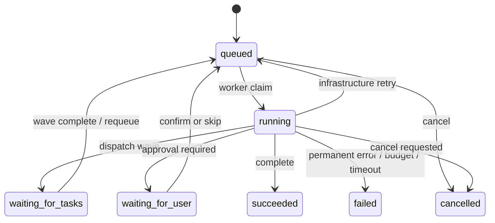

# KA Account Agent 运行时设计

本文说明当前代码中的 Run、队列、租约、状态迁移、模型/工具调用和故障恢复。架构总览见 [`architecture.md`](architecture.md)。

## 1. 运行时组件

```text
API
  └─ 创建 agent_runs + outbox_jobs
       └─ dispatcher
            └─ Redis/Celery broker
                 └─ Celery worker
                      ├─ claim run + acquire lease
                      ├─ PLAN / 子任务 / 工具 / ANSWER
                      ├─ checkpoint + events + trace
                      └─ complete / fail / requeue

sweeper
  ├─ 清理过期 run lease
  ├─ 队列在 Redis 里为空时，先按 queued Run 过滤，再补投 stale outbox（最多 3 次）
  ├─ 清理终态 Run 的旧 dispatched outbox
  └─ 唤醒等待子任务的 owner
```

主要实现路径：

- 入队：`backend/services/chat_run.py`、`backend/services/dispatcher.py`；
- Worker：`backend/celery/tasks.py`、`backend/services/run_worker.py`；
- 单 Run 执行：`backend/services/run_loop.py`；
- 父子任务：`backend/orchestrator/parent.py`、`backend/orchestrator/gather.py`；
- 清扫：`backend/services/sweeper.py`；
- 监控：`backend/services/monitor.py`、`backend/routes/runs.py`。

## 2. 状态机



- `queued`：等待 outbox/worker，或等待基础设施重试；
- `running`：持有 Run lease，正在执行；
- `waiting_for_tasks`：父 Run 已派出一波任务，释放 lease 等待子 Run；
- `waiting_for_user`：副作用或确认门等待用户；
- `succeeded`、`failed`、`cancelled`：终态。

状态迁移集中在 `backend/services/run_worker.py` 和 `backend/db/database/run.py`。工具函数本身不直接改变 Run 状态。

## 3. 聊天父 Run 和子 Run

聊天父 Run 的执行顺序是：

1. 读取 session、历史、摘要和长期记忆；
2. PLAN 生成结构化 `tasks[]`；
3. 按 `depends_on` 找出当前可执行波次；
4. 每项任务创建一个子 Run；
5. 父 Run 进入 `waiting_for_tasks` 并释放 lease；
6. 子 Run 完成后把结果写入 PostgreSQL checkpoint 和 Redis wave box；
7. 波次归零后重新入队父 Run；
8. 所有任务结束后执行 ANSWER，并由 `save_reply` 写入 session history。

`owner_run_id` 表示调度关系，`parent_run_id` 只表示重跑关系。子 Run 不直接写聊天 history，用户可见回复只由父 Run 的 ANSWER 产生。

## 4. 模型调用

`backend/llm/calls.py` 是统一模型调用入口。一次调用记录：

- provider、model、step 和 run；
- prompt/completion/total Token；
- usage 来源是厂商实际返回还是本地估算；
- latency、错误码、重试属性和响应摘要；
- 估算成本和 Run 预算消耗。

Run 可以设置最大模型调用次数和最大 Token。预算耗尽时不再请求厂商，记录 `COST_BUDGET_EXCEEDED`。

本地模型并发槽位不足和厂商 429/5xx/超时是两类问题：前者释放 Run lease 后回队列，后者按 ProviderError、Retry-After 和熔断策略处理。详细规则见 [`../retry.md`](../retry.md)。

## 5. 工具调用和副作用

工具注册信息包含参数 Schema、超时、是否有副作用、幂等要求和可重试错误。执行入口会：

1. 校验工具名和参数；
2. 检查作用域、开关和确认要求；
3. 对副作用工具先 claim 幂等键；
4. 调用工具并记录 `tool_calls`；
5. 只对注册为可重试的读工具做同一调用内重试；
6. 对可能已经发出的超时副作用记录 `response_lost`，不自动重试。

确认入口是 `backend/service.py` 的 `confirm()`，下单前消费确认 token，再执行确定性提交。

## 6. Checkpoint、事件和恢复

Checkpoint 保存工具循环、已完成工具、开放步骤、父 Run 任务和子任务结果。Run events 保存公开进度和内部恢复事件：

- 公开：`run.started`、`step.started`、`model.completed`、`tool.completed`、`run.reply_updated`、`run.completed` 等；
- 内部：`run.retry_scheduled`、`run.resumed`、`run.enqueued`、`run.queue_stale`、`run.budget_warning` 等。

SSE 先读取已经落库的事件，再通过 `LISTEN` 和 sequence cursor 补齐后续事件。断线重连通过 `after` 继续读取，不依赖浏览器内存。

Worker 消失、lease 过期或 outbox stale 时由 sweeper 和 outbox 机制重新投递。stale outbox 的查询以 `agent_runs(status='queued')` 为主表，并用 `queued_at` 部分索引和 `FOR UPDATE SKIP LOCKED` 避免旧终态 outbox 挤掉真正卡住的 Run。终态 Run 不重复执行；已经 claim 的副作用根据幂等键复用结果或进入人工复核。补投超过 3 次仍未被领取的 Run 进入 `failed` 和死信；排队超过 2 小时没有任何动静（`queued_at` 与 worker 重试心跳 `queue_heartbeat_at` 中较晚者）的 Run 以 `STUCK_QUEUE_EXPIRED` 失败并进入死信，不重放。

## 7. 当前运行时风险和优化项

- `/monitor` 已有完成时间、排队和阶段耗时的 P50/P95/P99。SLO、超时和并发默认值见 [`architecture.md`](architecture.md) 的「当前运行标准」。压测步骤见 [`../performance/performance-test-plan.md`](../performance/performance-test-plan.md)。
- 父 Run/子 Run 没有 `plan_version`。信封、失败码和恢复契约见 `tests/test_orchestrator_contract.py`。
- 测试中的 `work_chat` 同步 drain，生产通过 Celery 执行。两条路径都进入 `work_once`；租约过期后的续跑走 sweeper 的 `sweep_expired_leases`。契约见 `tests/test_execution_contract.py`。
- `response_lost` 目前没有通用的外部对账协议，副作用工具仍需人工介入。
- 模型路由、Prompt、工具 Schema 和检索索引版本应进入 Run trace，才能复现实验和回滚。

