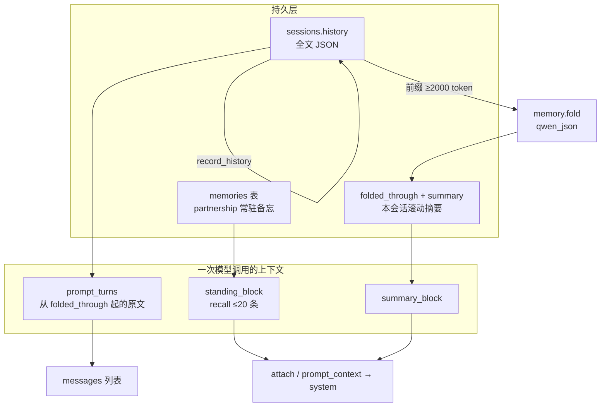
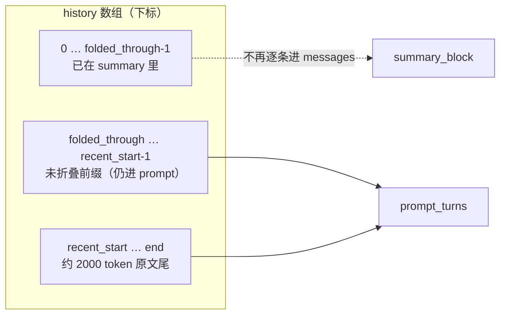
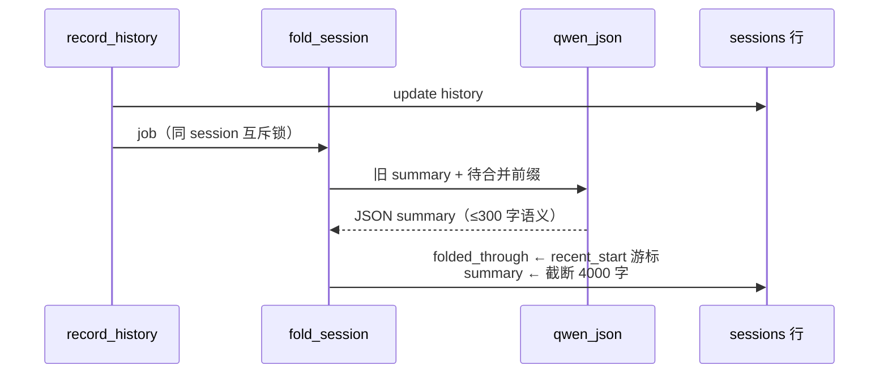

# 记忆：上下文总览

## 目录

0. 三条原则与全景图
1. 两种记忆速查
2. 会话 transcript：存什么、模型看什么
3. 滚动摘要（fold）
4. 常驻备忘（standing memory）
5. 拼进 system prompt
6. 与采购 / 规则的分工
7. 常量与边界
8. 代码位置
9. 与 [run.md](run.md)、[chat-flow.md](chat-flow.md) 的分工

---

## 0. 三条原则与全景图

1. **全文入库，提示词看裁剪**：`sessions.history` 完整保留，工作台全展示；模型只看到「备忘 + 滚动摘要 + 未折叠原文尾巴」。
2. **两类记忆，寿命不同**：`memories` 表跨会话；`summary` / `folded_through` 只属于当前会话。
3. **只作背景**：备忘和摘要不能放宽规则、不能改价格、不能授权折扣（文案写进 block 头）。

---

## 1. 两种记忆速查

| 维度 | 常驻备忘（standing） | 滚动摘要（session fold） |
|---|---|---|
| 存储 | `memories` 表 | `sessions.summary` + `folded_through` |
| 谁写 | 备忘页 HTTP；`remember()` | `fold_older` 一次模型调用 |
| 寿命 | 跨会话，可停用/删除 | 随会话，换会话即无 |
| 可见性 | 按 `user_id` 隔离同事笔记 | 仅该 `session_id` |
| 进 prompt | `memory_block` / `standing_block` | `summary_block` |
| 进 PO 代码检查 | **否**（只在 `operating_context`） | **否** |
| Run 轨迹 | — | 记 `tool: memory.fold`，幂等键 `memory.fold:{run_id}:{cursor}` |

---

## 2. 会话 transcript：存什么、模型看什么

| 对象 | 含义 |
|---|---|
| `history` | 全量消息；折叠**不删**行，只改游标 |
| `folded_through` | `history` 下标：此索引之前已并入 `summary` |
| `recent_start` | 从尾部往回约 **2000 token**，保证最新一段始终原文 |
| `prompt_turns` | `history[folded_through:]`，供多轮 messages |
| 待折叠区间 | `[folded_through, recent_start)`，原文仍在 prompt 里，直到够预算再 fold |

| 占位内容 | 是否进入 fold 转录 | 是否常见进 prompt |
|---|---|---|
| 正常 user / assistant 正文 | ✅ | ✅ |
| `(message)` / `(confirm)` / `(image)` | ❌ `_SKIP` | 视场景 |
| 单条正文 | fold 时单条 ≤8000 字 | extract 等另有上限 |

---

## 3. 滚动摘要（fold）

### 3.1 触发与时机

| 条件 | 行为 |
|---|---|
| 未折叠前缀 token ≥ **FOLD_TOKENS（2000）** | 可调一次 fold |
| `record_history` + 有 `llm` 且 `fold` 非 false | 满足上条则安排 fold |
| `speak.save_reply` | `fold=True`，worker 内可不带 vendor，fold 内再开正式 client |
| 无 `bind_fold_scheduler` | fold **同步**跑完（PO 确认、测试） |
| 有 scheduler（设计为 HTTP BackgroundTasks） | 先写 history，fold **延后**（先让用户看到回复） |

### 3.2 fold 一步

| 结果 | `folded_through` | `summary` | 用户 transcript |
|---|---|---|---|
| 成功 | 前移到 `recent_start` | 更新 | 不变 |
| 模型失败 / 空摘要 | 不变 | 不变 | 不变；下轮可再试 |
| 前缀未达预算 | 不调用模型 | 不变 | — |

> 与 [run.md](run.md)：`memory.fold` 非模型点选工具，由 `memory.py` 按预算触发，轨迹走 tool step。

---

## 4. 常驻备忘（standing memory）

### 4.1 数据模型

| 字段 | 说明 |
|---|---|
| `partnership_id` | 经销商合作关系 |
| `user_id` | 可选；空表示合作层面共享给「可见集合」 |
| `kind` | `preference` / `fact` / `instruction` / `event` |
| `source` | `user`（备忘页）/ `chat` / `system`（schema 预留；当前 mainly `user`） |
| `is_active` | 停用后 `recall` 不取 |
| `last_recalled_at` | 每次 `recall` 打点 |

### 4.2 recall 与展示

| 规则 | 值 |
|---|---|
| 顺序 | `id` 降序（新记的先出现在 block） |
| 单次 recall 上限 | **MAX_RECALLED = 20** |
| 拼进 prompt 总字符 | **MAX_BLOCK_CHARS = 1500**（超出截断，不扫全表） |
| 单条 content 入库 | ≤1000 字（空白规范化） |

### 4.3 谁能看见谁的备忘

| API / 函数 | 过滤 |
|---|---|
| 备忘页 `GET …/memories?user_id=` | 仅该用户的行 |
| `recall` / `standing_block` + `user_id` | 该用户 + `user_id IS NULL` 的共享行 |
| `recall` 无 `user_id` | 该 partnership 全部 active（管理/批量场景） |

| HTTP | 作用 |
|---|---|
| `GET /api/partnerships/{pid}/memories` | active / inactive + 预览 `block` |
| `POST …/memories` | `remember(..., source=user)` |
| `PATCH /api/memories/{id}` | 启用/停用 |
| `DELETE /api/memories/{id}` | 物理删除 |

---

## 5. 拼进 system prompt

| 助手函数 | 输出 |
|---|---|
| `memory_block(memories)` | 带「只作背景」头的 `- [kind] content` 列表 |
| `summary_block(summary)` | 带「本对话较早部分」头的滚动摘要 |
| `prompt_context(*parts)` | 非空 part 用 `\n\n` 拼接 |
| `attach(system, block)` | system 尾部追加一块 |
| `with_memory(operating_context, memories)` | 品牌 operating_context + 备忘（PO bundle） |

### 5.1 各路径怎么用

| 路径 | standing | summary | messages 历史 |
|---|---|---|---|
| 编排 PLAN / ANSWER | `_session_memory` | 同上 | `prompt_turns` |
| `speak.answer_directly` | ✅ | ✅ | `_chat_messages` |
| PO `load_bundle` | `with_memory` → `operating_context` | 各轮 `summary_block` + turns | `prompt_turns` |
| Text2SQL / 报表 / 品牌问答 | `standing_block` + actor | `summary_block` | `prompt_turns` 或专用裁剪 |
| PO 确认 `confirm_order` | bundle 内已 recall | — | `resolve_names=False`，不靠聊天 |

---

## 6. 与采购 / 规则的分工

| 能力 | 读 standing / summary？ | 说明 |
|---|---|---|
| PO 定价、SKU、MOQ、规则检查 | **否** | 确定性 `po/check`；备忘只在 extract/reply 的 **system** |
| fold 提示词 | 显式要求 | 不写价格、SKU、折扣、总额、起订量 |
| 模型从备忘「改价」 | **不生效** | 商业结果以代码为准 |

---

## 7. 常量与边界

| 常量 | 值 | 含义 |
|---|---|---|
| `RECENT_TOKENS` / `FOLD_TOKENS` | 2000 | 原文尾预算 / 触发 fold 的前缀预算 |
| `_ROLE_TOKENS` | 4 | 每条消息角色标签估算 |
| `_SUMMARY_CHARS` | 4000 | summary 列上限 |
| fold 模型输出 | ≤300 字（提示词要求） | 滚动摘要语义长度 |
| `estimate_tokens` | CJK≈1字1 token；其它≈4字1 token | 预算估算（非 tiktoken） |

---

## 8. 代码位置

| 文件 | 职责 |
|---|---|
| `backend/memory.py` | fold / recall / `record_history` / block 拼装 / scheduler |
| `backend/db/database/memory.py` | CRUD、`mark_memories_recalled` |
| `backend/db/orm/memory.py` | `memories` 表 |
| `backend/schemas/memory.py` | Pydantic + 备忘页 body |
| `backend/router/memory_router.py` | 备忘 REST |
| `backend/db/orm/chat.py` | `history`、`folded_through`、`summary` |
| `backend/orchestrator/speak.py` | 聊天写 history + `fold=True` |
| `backend/po/turn.py` | `load_bundle` 注入 operating_context；轮末 `record_history` |
| `frontend/src/pages/Memory.tsx` | 备忘桌面 |
| `tests/test_memory.py` | 行为契约（fold、隔离、PO、编排） |

---

## 9. 与 [run.md](run.md)、[chat-flow.md](chat-flow.md) 的分工

| 文档 | 写什么 | 不写什么 |
|---|---|---|
| **memory.md（本文）** | 两层记忆、fold 预算、prompt 裁剪、备忘隔离 | Run 状态机、sweeper |
| **run.md** | `memory.fold` 在轨迹里的位置、非模型工具 | fold 算法与 token 估算 |
| **chat-flow.md** | `save_reply` → `record_history` 在消息链路上的位置 | 备忘页与 `memories` 表细节 |

阅读顺序：聊天链路先看 **chat-flow.md** 写 history；长对话压缩与备忘页看本文 §0–§4；查 fold 失败是否影响回复见本文 §3.2 与 **run.md** 工具表。