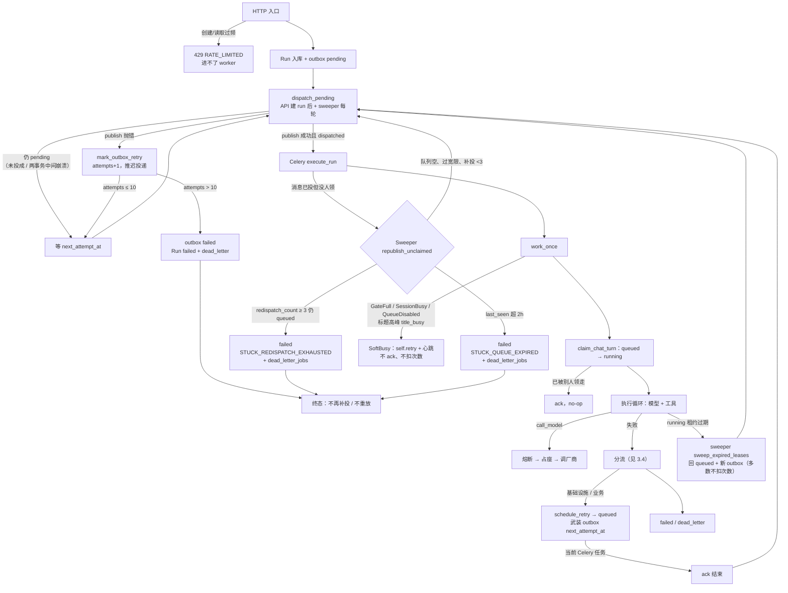
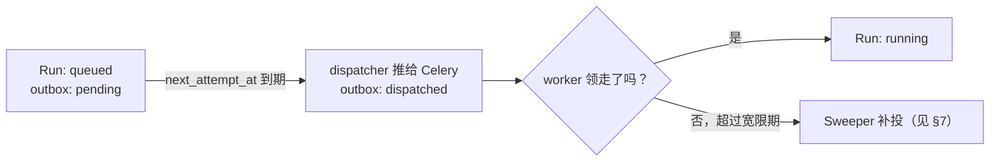
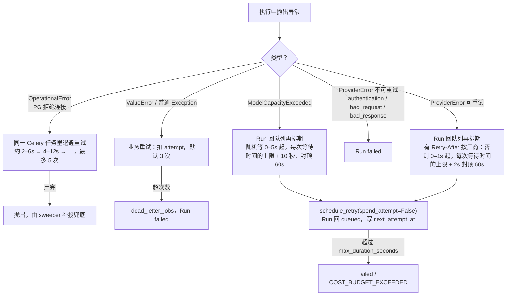
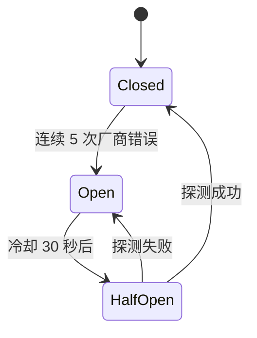
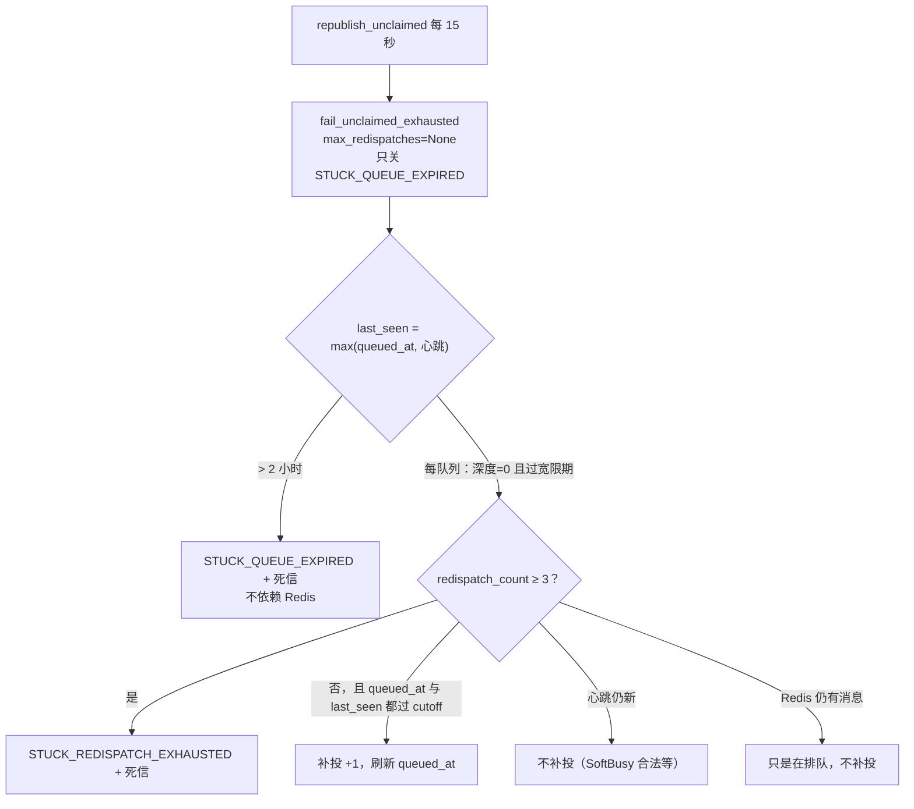

# 报错与重试：兜底机制总览

## 目录

0. 三条原则与全景图
1. 兜底速查表（按执行进度）
2. 先分类：三种“限流”与 ProviderError
3. 按阶段展开
   - 3.1 入口：HTTP 限流
   - 3.2 投递：outbox → Celery
   - 3.3 领取前后：SoftBusy 三兄弟
   - 3.4 执行中：模型调用失败的分流
   - 3.5 流式输出与 generation_id
   - 3.6 `running`：租约清扫、Redis 闸门与 `LeaseLost`
   - 3.7 重复执行：checkpoint 与工具幂等（概要）
4. 等多久：Retry-After 与退避
5. 重试预算：什么扣次数，什么不扣
6. 熔断器
7. Sweeper：queued Run 的最后一道网
8. 重试顺序是 FIFO 吗
9. 配置、调参、代码位置
10. 与 [run.md](run.md) 的分工

---

## 0. 三条原则与全景图

1. **先分类，再处理**：入口限流、本地槽满、厂商故障名字不同、`code` 不同、处理者不同。
2. **只让一层负责等**：client 和 `call_model` 只抛错，不 sleep、不重试，统一由 worker 决定等多久。
3. **基础设施重试不扣次数，用时长封顶**：业务重试才扣次数、进死信。



---

## 1. 兜底速查表（按执行进度）

| 阶段 | 故障 | 谁处理 | 怎么兜 | 扣 attempt？ | 最终去向 |
|---|---|---|---|---|---|
| ① 入口 | 创建/读取 Run 太频繁 | HTTP 入口 | 返回 429 `RATE_LIMITED` | — | 前端提示 |
| ② 投递 | 推 Celery 失败，outbox 仍 `pending` | `mark_outbox_retry` | 推迟 `next_attempt_at`，同一 pending 行最多 **10 次** | 否 | 超限则 outbox `failed` + 死信 |
| ② 投递 | `_publish` 成功但 `dispatched` 没写上 | sweeper `dispatch_pending` | 重推 pending | 否 | 可能重复 `run_id`（见 3.7） |
| ② 投递 | 消息已 dispatched，Run 仍 queued | sweeper | 补投（≤3 次）；`queued_at` 与心跳都须过宽限期 | 否 | `STUCK_REDISPATCH_EXHAUSTED` + 死信 |
| ② 投递 | 排队超 2 小时无动静 | sweeper | 直接关闭，不补投（第一轮先扫，不依赖 Redis） | 否 | `STUCK_QUEUE_EXPIRED` + 死信 |
| ③ 领取前 | 并发座位满 `GateFull` | Celery retry | **5–15 秒**随机 jitter + 心跳 | 否 | 等到有位 |
| ③ 领取中 | 同会话有 Run 在跑 `SessionBusy` | Celery retry | 约 10 秒后重试 + 心跳 | 否 | 等到会话空闲 |
| ③ 领取前 | 队列开关关闭 `QueueDisabled` / `QUEUE_ENABLED` 关 | Celery retry | 约 30 秒后重试 + 心跳 | 否 | 等到开关打开 |
| ③ 领取前 | 标题 OPEN 队列高峰 `title_capacity_busy` | Celery retry | 带 jitter 重试 + 心跳；超限则跳过精修标题并 ack | 否 | 侧边栏保留临时标题 |
| ③ 领取 | 重复投递，另一个已在跑 | worker | claim 失败 → ack，no-op | — | 无 |
| ④ 执行 | Postgres 拒绝连接 `OperationalError` | `execute_run` | 同一 Celery 任务内再试：约 2–6s、4–12s… 最多 **5 次** | 否 | 仍失败交给 sweeper |
| ④ 执行 | 本地模型槽满 `ModelCapacityExceeded` | worker | Run 回队列，随机等 **0–5s** 起，逐次加长，**单次最多等 60s** | 否 | 超 Run 时长则失败 |
| ④ 执行 | 厂商 429/5xx/超时/断网 | worker + 熔断器 | 有 **Retry-After** 按厂商说的等（最多 5 分钟）；否则 **0–1s** 起逐次加长，单次最多 60s | 否 | 超 Run 时长则失败 |
| ④ 执行 | Run 级 token/调用顶 `ModelBudgetExceeded` | `call_model` | 本步 `model.failed`，**不**走基础设施排队 | — | 循环继续或 Run 失败（见 `run.md`） |
| ④ 执行 | Redis 运行座位丢失 `LeaseLost` | worker | ack 结束，Run 仍 `running` 交给租约清扫 | 否 | sweeper 回 `queued` |
| ④ 执行 | `running` 租约过期（worker 挂/卡住） | sweeper | 回 `queued` + 新 outbox（见 3.6） | 否 | `attempts≥3` 则 `failed` |
| ④ 执行 | 401/403/400/422/响应非对象 | worker | 不重试 | — | Run `failed` |
| ④ 执行 | 模型输出 JSON 解析失败（`ValueError`）等普通异常 | worker | 业务重试，默认 3 次 | **是** | 超次数进 `dead_letter_jobs`，Run `failed` |
| ⑥ 续跑 | 租约回收 / broker 重投后再次执行 | worker 循环 | checkpoint + 工具幂等键（见 3.7） | — | 已完成的工具不重复副作用 |
| ⑤ 丢失 | worker 丢失导致 broker 重投 | `record_worker_loss_redelivery` | 在 outbox `last_error_json` 计数，最多 **3** | 单独计 | `WORKER_LOST_REDELIVERY` → 死信；`waiting_for_user` 直接 ack |

> 工具上游 429（`TOOL_RATE_LIMITED`）不在本文范围，仍由 `run_loop` 按工具注册表处理。

---

## 2. 先分类：三种“限流”与 ProviderError

### 2.1 三种“限流”

| 发生在哪 | Python 类型 | 内部 `code` | 谁处理 |
|---|---|---|---|
| 创建/读取 Run 太频繁 | `AppError(429, …)` | 对外仍是 `RATE_LIMITED` | HTTP 入口，进不了 worker |
| 本地 `acquire_model()` 槽满 | `ModelCapacityExceeded` | `MODEL_CAPACITY_EXCEEDED` | worker，不扣业务次数 |
| 厂商 429 / 5xx / 超时 / 断网 | `ProviderError` | `PROVIDER_RATE_LIMITED` 等 | worker + 熔断器 |

对外码不改，因为前端已经认入口的 `RATE_LIMITED`。内部拆开，是因为“本地槽满”和“厂商 429”的监控含义不同。

### 2.2 `ProviderError.kind`

| kind | 典型来源 | 可重试 | 进熔断器 |
|---|---|---|---|
| `rate_limited` | HTTP 429 | ✅ | ✅ |
| `server_error` | 500 / 502 / 503 / 504 | ✅ | ✅ |
| `timeout` | 连接 / 读超时 | ✅ | ✅ |
| `network` | 断连、DNS | ✅ | ✅ |
| `circuit_open` | 熔断器打开 | ✅ | ❌（避免自己把自己重新打开） |
| `authentication` | 401 / 403 | ❌ Run 失败 | ❌ |
| `bad_request` | 400 / 422 | ❌ | ❌ |
| `bad_response` | 200 但响应不是对象 | ❌ | ❌ |

`ValueError`（模型输出 JSON 解析失败）不算厂商故障，走业务重试，见 §5。

---

## 3. 按阶段展开

### 3.1 入口：HTTP 限流

- 出发先流条件：1）本分钟创建 run 的次数，经销商 1000次/分钟，用户 200次/分钟；2）并发作为满，全局并发 100，org 10，user 5。
- 触发限流，直接返回 `AppError(429)`，对外 `RATE_LIMITED`。
- 请求到不了 worker，不产生 Run，也没有后续兜底。

### 3.2 投递：outbox → Celery



**推 Redis 与写 `dispatched` 是两笔事务**（`dispatcher._publish` 然后 `mark_outbox_dispatched`）。中间崩溃会留下 pending 或已投未标；sweeper 每轮 `dispatch_pending` 处理仍 pending 的行。已进 broker 但未标 dispatched 时，可能再推一条相同 `run_id`——靠 §3.7 的 claim 与 checkpoint 去重。

#### 3.2.1 三条「等一等再跑」通道

同一 Run 有三种互斥的等待方式。**不要混成「都是 Celery 在重试」。**

| 通道 | Run 状态 | 当前 Celery 消息 | 谁安排下一次 | 典型触发 |
|---|---|---|---|---|
| **SoftBusy** | `queued` | **不 ack**，`self.retry`（ETA 在 worker 内存） | 同一条任务稍后自旋 | 闸门满、同会话冲突、队列关、标题高峰 |
| **`schedule_retry`** | 先 `running` 再回 `queued` | **ack 结束** | outbox `pending` + `next_attempt_at` → `dispatch_pending` → 新 `execute_run` | 厂商可重试错误、槽满、业务异常、`OperationalError`（在 worker 内） |
| **Sweeper 补投** | `queued` | 再 `_publish` 一条 | `republish_unclaimed` | 已 dispatched 长久无人 claim、消息真丢（且队列深度为 0） |

基础设施/厂商失败后，用户侧看到的是 Run 回到 `queued`，但 **broker 里那条任务已经 ack**；等待时间写在 outbox 的 `next_attempt_at` 上，到期才再进 Celery。

#### 3.2.2 两套 outbox 次数

| 预算 | 字段 / 常量 | 默认 | 扣什么 |
|---|---|---|---|
| **推 Celery** | `OutboxJob.attempts`，`max_attempts` 默认 **10** | 10 | `mark_outbox_retry`：publish 抛错时推迟，超限 outbox `failed` + 死信 |
| **执行业务** | `EXECUTION_MAX_ATTEMPTS`，执行 outbox `max_attempts == 3` | 3 | `schedule_retry(spend_attempt=True)`：循环内不可恢复错误；与 `agent_runs.attempts`（进 `running` 的次数）相关 |

租约清扫、基础设施 `schedule_retry(spend_attempt=False)`、SoftBusy **都不**增加执行 outbox 的 attempts。`infrastructure_attempts` 只记在 `last_error_json` 里，用来算指数退避（封顶 60 秒），见 §5。

**Celery 与 outbox 的分工：**

| 层 | 负责 | 不负责 |
|---|---|---|
| Celery `execute_run`（`max_retries=None`） | 队列关闭和各类 SoftBusy（`SessionBusy`、`GateFull`、`QueueDisabled`，以及 title 高峰软降级）；PG 连接拒绝时任务内重试 ≤5 次 | 厂商错误的长等待（由 outbox 到期再投）；worker 丢失的计数在 PG |
| outbox（PostgreSQL） | 基础设施/业务 `schedule_retry` 后的再投递；worker 丢失 `record_worker_loss_redelivery` | SoftBusy（Run 一直是 queued，靠同一条 Celery 自旋） |

`acks_late=True` + `reject_on_worker_lost=True`：进程丢时 broker 可再投；与 sweeper 补投、§3.7 claim 叠用。

### 3.3 领取前后：SoftBusy 三兄弟

SoftBusy 指 Run 本身没问题，只是“现在不该跑”。处理方式一致：**self.retry + 打心跳，不 ack，不扣次数。**

| 类型 | 触发点 | 触发条件 | 重试间隔 |
|---|---|---|---|
| `GateFull` | `work_once` 里，**`claim_chat_turn` 之前** | `acquire_run` 拿不到 Redis 座位（全局 / org / user 并发满） | **5–15 秒**随机 |
| `SessionBusy` | `claim_chat_turn` **之中** | 同会话已有 chat run 处于 `running` 或 `waiting_for_tasks`；`ChatTurnBusy` 被包装成 `SessionBusy` | 默认 10 秒 |
| `QueueDisabled` | `execute_run` 领取前 | `QUEUE_ENABLED` 关或队列开关关闭 | 约 30 秒 |
| 标题高峰 | `execute_run`（OPEN / `ka_account.title`） | `title_capacity_busy` | jitter；超 `TITLE_BUSY_MAX_RETRIES` 则 ack 并保留临时标题 |

**对比重复投递：同样是“第二个人没拿到”，处理不同。**

| 场景 | Run 状态 | 第二个 worker / 第二次投递怎么办 |
|---|---|---|
| 双投递，第一个已在跑 | `running` | claim 失败 → **ack，no-op** |
| 同会话第二条消息在等 | `queued` | `SessionBusy` → **retry + 心跳，不 ack** |
| 并发闸门满 | `queued` | `GateFull` → **retry + 心跳，不 ack** |

判断标准：Run 已经有人在跑，就 ack 掉重复消息；Run 还在等，就保留消息继续重试。

**为什么要打心跳：** Celery 的 `self.retry` 把任务当作带 ETA 的消息放在 worker 内存里，此时 Redis 队列可以是空的，而 Run 其实在合法等待。不留痕的话，sweeper 会把它当成丢了去补投，等久了还会按超龄关掉。

- 每次重试前，worker 把 `agent_runs.queue_heartbeat_at` 写成当前时间。
- 补投和超龄都以 **`max(queued_at, queue_heartbeat_at)`** 判断。
- 心跳单独存一列，不动 `queued_at`，监控里“排队多久了”仍是真实入队时间，过载时看得出来。
- 写心跳失败不会阻止重试。

### 3.4 执行中：模型调用失败的分流



要点：

- `OperationalError` 如果不在任务内重试，消息会被 ack，Run 却停在 `queued`，所以要先重试，再交给 sweeper。
- 采购、合同、报表、查数、子任务里**对 `ModelCapacityExceeded` 的放行同样适用于 `ProviderError`**，避免厂商 503 被收成工具 `ok: false`。
- **`ModelBudgetExceeded`**：本条 Run 的 `max_model_calls` / `max_tokens` 已用尽，**不调厂商**，记 `model.failed` / `COST_BUDGET_EXCEEDED`。这是 Run 级预算，不是本地槽满，**不走** `schedule_retry` 基础设施排队；与 org 日预算（`org_budget`）是另一层闸门。
- 基础设施路径在 `run_worker._finish_claimed` 里 `schedule_retry` 后 **`return True` → Celery ack**；下次执行靠 §3.2.1 的 outbox 通道，不是 broker 里挂着同一条任务。

### 3.5 流式输出与 generation_id

| 项 | 做法 |
|---|---|
| 标识 | 每次 `call_model` 带 `on_text` 时发一个 `generation_id`，写进 running 的 `output_json`：`{ "text": "Hel", "generation_id": "…" }` |
| 前端 | `followRun` 看到新的 `generation_id` 就丢掉上一轮 live token，从新文本开始画 |
| 半截 503 | worker 先写一轮空文本 + 新 id，再把 Run 放回 queued，避免失败那段一直挂在屏幕上 |
| 增量推送 | 正文增量通过 `run.reply_updated` 事件推送 |
| 成功提交 | `complete_run` 仍只写最终 `{ "text": "…" }` |

> 不要在客户端把第二次请求的 token 接到第一次后面。重试是整段 Run 再领一次，是新的 generation。

### 3.6 `running`：租约清扫、Redis 闸门与 `LeaseLost`

**Postgres 行租约**（`lease_owner`、`lease_expires_at`，领取时默认 **+10 分钟**）与 **`queue_heartbeat_at`**（仅 `queued` + SoftBusy）无关；执行中 **不会**续 Postgres 租约。父 run 进 `waiting_for_tasks` 会清掉租约，长活多在子 run 上。

| 机制 | 何时 | 做什么 |
|---|---|---|
| `sweep_expired_leases` | `running` 且 `lease_expires_at < now` | 已请求取消 → `cancelled`；`attempts ≥ 3` → `failed`；否则回 `queued` + 新 `execute_run` outbox，事件 `run.requeued_by_sweeper`（**不**花执行 outbox attempts） |
| Redis `acquire_run` 座位 | `execute` 期间后台 renew | 座位丢 → `LeaseLost` → worker ack，不 `fail_run`；靠租约清扫回收 |
| `sweep_waiting_for_tasks` | 子女都终态、父仍 `waiting_for_tasks` 超 15 分钟 | 父回 `queued` + outbox（见 `run.md` 清扫表） |

### 3.7 重复执行：checkpoint 与工具幂等（概要）

broker / sweeper 可能让**同一条 `run_id` 再次被领取**，或 worker 在中途挂掉后续跑。除 §3.3 的 claim 外，**已进入循环**后靠：

1. checkpoint 的 `last`：已是 `tool_result:` 则不再调该工具。
2. `assistant:tool_use:` 步按幂等键查 `tool_calls`：成功则复用；副作用撞键则 `skipped_duplicate` / 不发第二次。
3. 发信、MCP 业务键；卡在 `running` 超 90 秒的副作用 → `response_lost` + `tool.manual_review`。

逐步与工具表见 [run.md](run.md)（「投递重复」「worker 中途消失」）。本文不重抄表，只标明：**重试文档管「怎么再进队列」；run 文档管「进来之后别重复副作用」。**

---

## 4. 等多久：Retry-After 与退避

`Retry-After` 是响应头，不是异常类型，值可能是秒数（`Retry-After: 12`），也可能是 HTTP 日期。解析后存为 `ProviderError.retry_after_seconds`。

**等多久**（精确公式在 `tasks.db_retry_countdown`、`queue.schedule_retry`）：

| 情况 | 人话 |
|---|---|
| **PG 连不上** | 还在**同一条 Celery 任务**里重试，不进 outbox。第 1 次大约等 **2–6 秒**，第 2 次大约 **4–12 秒**……（每次都是「2–6 秒」× 第几次）。**最多 5 次**，仍连不上就抛错，靠 sweeper 补投。 |
| **本地模型座满** | Run 先变 `queued`，到期再发新 Celery。在 **0–5 秒**里随机挑一个时刻再跑；若老失败，等待上限逐步涨到 **最多 60 秒**。不扣 3 次业务 attempt。 |
| **厂商可重试（429/5xx 等）** | 同上，Run 回队列再排期。响应头有 **Retry-After** 就按厂商建议等（略加随机，**最长 5 分钟**）。没有的话从 **0–1 秒**起同样「越等越久」，**单次最多 60 秒**。 |

`schedule_retry(..., spend_attempt=False)` 把等待写在 outbox 的 `next_attempt_at`；传入 `delay` 可覆盖计算出的等待。

**以前和现在：**

| | 以前 | 现在 |
|---|---|---|
| 重试层数 | SDK 重试 × 客户端循环 × worker 再试，层层叠加 | 只有 worker 一层 |
| client | 自己重试 | OpenAI SDK `max_retries=0`，一次失败就抛，不 sleep |
| `call_model` | 可能 sleep | 查熔断 → 占座 → 调用 → 记账，不 sleep、不重试 |

---

## 5. 重试预算：什么扣次数，什么不扣

| | 业务重试 | 基础设施重试 |
|---|---|---|
| 包括 | 普通 `Exception`、模型输出解析失败 | 本地槽满、厂商可重试错误、DB `OperationalError` |
| 扣 execution outbox `attempts` | ✅ | ❌ |
| 次数上限 | 默认 **3** 次（`EXECUTION_MAX_ATTEMPTS`） | 暂无（靠 `max_duration_seconds`） |
| 推 Celery 失败 | 另一套：`mark_outbox_retry`，最多 **10** 次（§3.2.2） | — |
| 间隔 | 现为 1 / 5 / 15 分钟 | 见 §4；`infrastructure_attempts` 指数封顶 60s |
| 进死信 | 超次数进 `dead_letter_jobs`，Run failed | **不会因次数进死信** |
| 收场条件 | 次数用尽 | Run 的 `max_duration_seconds`：领到时已超时，或 sweeper 扫到超时 → `failed` / `COST_BUDGET_EXCEEDED` |

基础设施重试在 `schedule_retry(..., spend_attempt=False)` 里把 `infrastructure_attempts` 写入 outbox `last_error_json`，**不加** execution `attempts`。

**为什么基础设施重试不设次数上限：** 高峰时一条 Run 可能要连续等好几轮 429，按次数死信会在厂商恢复前就把对话判死。次数上限以后再说，现在靠时长封顶。

**待改：** 业务重试间隔对话场景偏长。用户还在等 SSE，5 分钟这一档过长，应改成 5 秒、30 秒；长退避只留给没人盯着的后台任务。

---

## 6. 熔断器

| 项 | 说明 |
|---|---|
| 粒度 | 按 **brand**（`qwen` / `deepseek` / `glm`）一把 Redis 钥匙，不按模型名 |
| 计入 | 429、5xx、timeout、network |
| 不计入 | 本地槽满、401、400、解析失败、`circuit_open` 本身 |
| 打开条件 | **连续 5 次**上述错误 |
| 打开后 | 冷却 **30 秒**，`call_model` 不发请求，抛 `ProviderError(kind=circuit_open)`，worker 按基础设施重试 |
| 冷却结束 | 允许**一次** half-open 探测：成功则关闭，失败再打开 30 秒 |
| 熔断器自己坏了（Redis 报错） | **放行**，避免闸门把所有模型调用挡住 |



环境变量：

```text
KA_ACCOUNT_CIRCUIT_FAILURES=5          # 0 表示关掉熔断
KA_ACCOUNT_CIRCUIT_COOLDOWN_SECONDS=30
```

**怎么调：**

| 现象 | 调整 |
|---|---|
| 几乎都是 429 且带 Retry-After（日常配额不够，不是厂商宕机） | 阈值调到 10–20，冷却缩短，让 Retry-After 当主节奏 |
| `Retry-After` 经常是 6–12 秒 | 冷却 30 秒偏保守，可改 15 |
| 连续 502 / 超时 | 阈值低一点，冷却长一点 |
| 打开后探测仍然 503 | 保持 30 或加到 60 |
| 阈值过小（如 2） | 一次抖动就全员排队 |
| 阈值过大（如 50） | 厂商明确挂了还在继续打 |

判断依据：`model_calls.error_json` 的 `kind` 和 `retry_after_seconds`，以及 outbox 的 `infrastructure_attempts`。先看监控里 `PROVIDER_RATE_LIMITED` 是否成片出现、有没有伴随 5xx。

---

## 7. Sweeper：queued Run 的最后一道网

**它兜什么：** Celery 消息已标成 `dispatched`，但 worker 没有把 Run 从 `queued` 领走（消息丢了、worker 挂了、重试用尽等）。

### 7.1 判断流程

每轮 `sweep` 大致顺序：`sweep_expired_leases` → `sweep_waiting_for_tasks` → `sweep_attention` → **`republish_unclaimed`**（超龄 + 补投）→ `dispatch_pending` → 清理旧 dispatched outbox。



### 7.2 关键规则

| 规则 | 内容 |
|---|---|
| 补投前先看队列深度 | 聊天 Run 看 `ka_account`，标题（OPEN）Run 看 `ka_account.title`，各队列分别判断。Redis 里还有消息就是在排队，不补投也不判耗尽；读不到 Redis 也跳过 |
| 为什么先看深度 | 积压的队列被补投会出更多重复消息，积压更深。A3 r2：标题队列积压 p50 244 秒，补投事件 3083 次，24 个健康 Run 被误判 `STUCK_REDISPATCH_EXHAUSTED` |
| 真丢消息怎么办 | 由“超龄关闭”兜底 |
| 为什么超龄不重放 | 发消息的人早已不在等，重跑只会为没人读的回复付模型费 |
| 宽限期 | 默认 120 秒（`KA_ACCOUNT_REDISPATCH_AFTER_SECONDS`）。取长是因为排队很深时 Run 只是在等，每补投一次就少一次机会 |
| 补投上限 | 每条 Run 最多 3 次 |

### 7.3 补投的并发与一致性

| 点 | 做法 |
|---|---|
| 查询 | 从 `agent_runs` 出发，筛 `status='queued'`、**`queued_at` 与 `max(queued_at, queue_heartbeat_at)` 都**早于宽限期 cutoff、存在老的 `dispatched execute_run`，按 `queued_at` 限 100 条；有心跳则不算 unclaimed |
| 仍 pending | 每轮 `dispatch_pending`：`next_attempt_at` 到期的行再推 Celery（含 `schedule_retry` 武装的行） |
| 防重复领取 | `FOR UPDATE SKIP LOCKED` 锁 Run，同一事务内 `redispatch_count+1` 并刷新 `queued_at`，多个 sweeper 不会拿到同一条 |
| 领取节奏 | 每次只领一条并立即发布 |
| 发布抛错 | 仅在 Run 仍处于同一次 queued 领取状态下回退次数，后续 Run 不消耗预算 |
| 发布结果不确定 | 可能重复投递，由 worker 的 queued→running 领取保证只有一个执行者 |

### 7.4 outbox 清理

| 项 | 规则 |
|---|---|
| 清理对象 | 超过保留期（默认 7 天）、且对应 Run 已终态的 `dispatched` outbox |
| 批量 | 每轮最多 1000 条；先在数据库里排除仍活跃的 Run 再限批量，避免旧的活跃行挡住后续可清理行 |
| 不清理 | 仍 `queued` 的 outbox，保留补投依据 |

---

## 8. 重试顺序是 FIFO 吗

**不是严格 FIFO。** 到期后按 `next_attempt_at` 从早到晚取。

| 层 | 行为 |
|---|---|
| Outbox | `find_pending_outbox_jobs` 只拿 `status=pending` 且 `next_attempt_at <= now` 的行，`ORDER BY next_attempt_at`。首次入队时 `next_attempt_at` 约等于创建时间，所以看起来像 FIFO；被 429 打回、要等 12 秒的那条，会排到已到期的其它 Run 后面 |
| Celery | dispatcher 把到期 outbox 推进 broker，broker 内大致按投递顺序；并发 worker 领到就跑，不保证与 outbox 扫描顺序逐条对应 |

结论：没有 Retry-After、同时到期的 Run 接近 FIFO；带着更长等待回来的 Run 会让路给已到期的。这是有意的，厂商说 12 秒后再来，就不要插队去抢那 10 次/分钟的配额。

---

## 9. 配置、调参、代码位置

### 9.1 配置项与默认值

| 配置 | 默认 | 含义 |
|---|---|---|
| `KA_ACCOUNT_CIRCUIT_FAILURES` | 5 | 熔断阈值，0 关闭 |
| `KA_ACCOUNT_CIRCUIT_COOLDOWN_SECONDS` | 30 | 熔断冷却 |
| `KA_ACCOUNT_REDISPATCH_AFTER_SECONDS` | 120 | 补投宽限期 |
| `KA_ACCOUNT_QUEUED_MAX_AGE_SECONDS` | 7200（2 小时） | 排队超龄关闭 |
| Retry-After 上限 | 300 秒 | 写死在 worker |
| 补投上限 | 3 次 / Run | — |
| 业务执行重试 | 3 次 | `EXECUTION_MAX_ATTEMPTS` |
| 推 Celery 失败重试 | 10 次 | `OutboxJob.max_attempts` 默认 |
| Celery PG 连接重试 | 5 次 / 任务 | `DB_CONNECT_MAX_RETRIES` |
| worker 丢失 broker 重投 | 3 次 | `WORKER_LOST_MAX_REDELIVERIES` |
| outbox 保留期 | 7 天 | 清理任务 |

### 9.2 失败码速查

| 错误码 | 触发 | 是否进死信 |
|---|---|---|
| `RATE_LIMITED` | 入口限流 | — |
| `MODEL_CAPACITY_EXCEEDED` | 本地模型槽满（内部，会重试） | ❌ |
| `PROVIDER_RATE_LIMITED` 等 | 厂商错误（内部，会重试） | ❌ |
| `COST_BUDGET_EXCEEDED` | Run 超过 `max_duration_seconds` | — |
| `STUCK_REDISPATCH_EXHAUSTED` | 补投 3 次仍没人领 | ✅ |
| `STUCK_QUEUE_EXPIRED` | 排队超 2 小时无动静 | ✅ |
| `WORKER_LOST_REDELIVERY` | broker 因 worker 丢失反复重投同一任务 | ✅（Run 已 `waiting_for_user` 时直接 ack，不进此计数） |

### 9.3 代码位置

| 文件 | 职责 |
|---|---|
| `backend/celery/tasks.py` | `execute_run`：SoftBusy / 心跳、`OperationalError` 任务内重试、worker 丢失计数 |
| `backend/services/dispatcher.py` | `_publish` / `mark_outbox_dispatched`、`republish_unclaimed`、队列深度 |
| `backend/services/sweeper.py` | 清扫编排：租约、补投、`dispatch_pending` |
| `backend/services/run_worker.py` | `work_once`、`schedule_retry` 分流、`LeaseLost` |
| `backend/services/entry_guard.py` | Redis 运行闸门 `acquire_run`、座位 renew |
| `backend/db/database/queue.py` | `schedule_retry`、`mark_outbox_retry`、`fail_unclaimed_exhausted`、`record_worker_loss_redelivery` |
| `backend/db/database/run.py` | `touch_queue_heartbeat`、`claim_unclaimed_dispatches`、`sweep_expired_leases` |
| `backend/llm/errors.py` | `ProviderError`、`Retry-After` 解析、SDK/HTTP 映射 |
| `backend/llm/client.py` | 适配层，`max_retries=0` |
| `backend/llm/calls.py` | `call_model`：熔断 → 占座 → 调用；`ModelBudgetExceeded` |
| `backend/llm/breaker.py` | Redis 熔断器 |
| `frontend/src/chat-live.ts` | `liveFromRun`：generation_id 变了就清空 live |

---

## 10. 与 [run.md](run.md) 的分工

| 文档 | 写什么 | 不写什么 |
|---|---|---|
| **run.md** | Run 生命周期、状态机、一次消息的 HTTP→worker 路径、sweeper 清扫表、工具与 checkpoint 逐步细节 | 厂商 Retry-After、熔断调参、三种限流拆开讲 |
| **retry.md（本文）** | 所有「慢一点再试 / 别重复副作用 / 别把 Run 误杀」的兜底分类与预算 | 页面 SSE、编排 PLAN/ANSWER、子 run 波次细节 |

阅读顺序建议：先 **run.md** 的「一次消息」与三段 **投递重复**，再读本文 §0 全景与 §3.2.1 三条通道；查具体工具幂等键时回 **run.md**「工具」与「worker 中途消失」五层表。